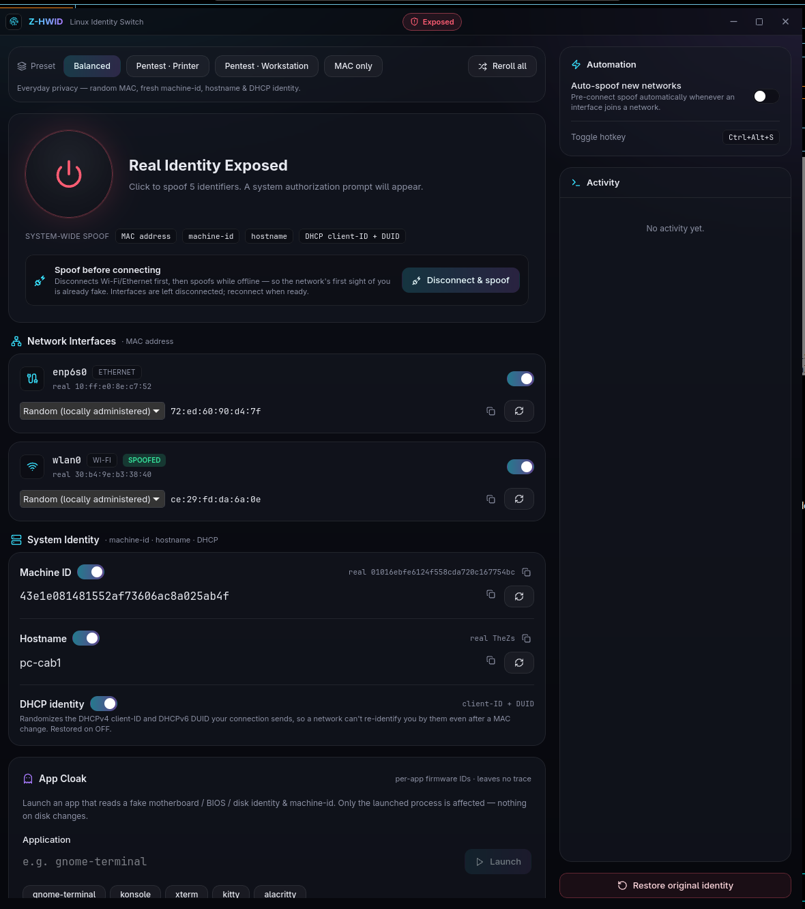
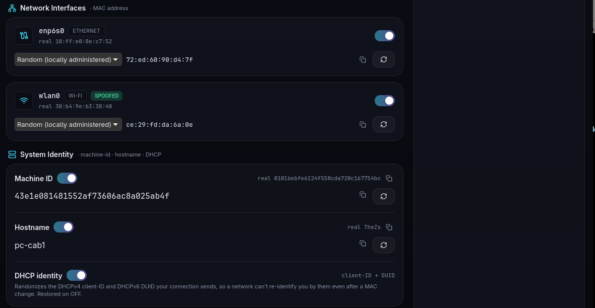
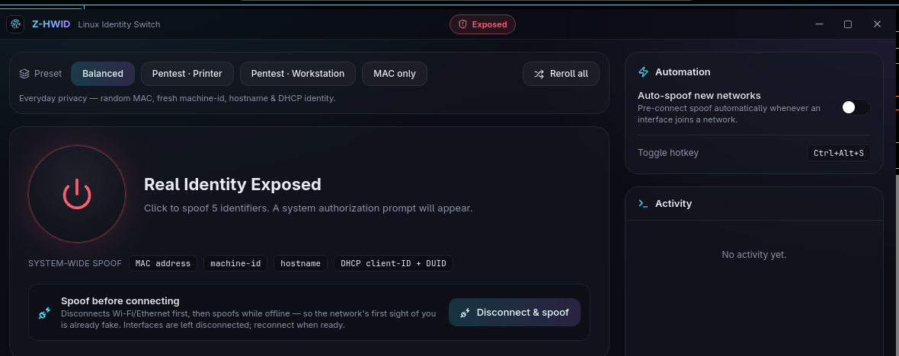

<div align="center">


# Z&#8209;HWID

### Linux Identity Switch

**One toggle to spoof your machine's network &amp; system identity — and one to put it all back.**

Change your MAC address, `machine-id`, hostname and DHCP identity system&#8209;wide with a single click,
hand a fake hardware fingerprint to any individual app, and restore your real identity at any time.
A modern desktop app **and** a scriptable CLI, built for privacy on untrusted networks and for
authorized security testing.

<br/>


<br/>



</div>

<br/>

> [!IMPORTANT]
> Z-HWID is a **privacy and security-testing utility** — a friendly front-end over the same
> operations as `macchanger`, `systemd-machine-id-setup`, `hostnamectl` and NetworkManager.
> It is **not** an anti-cheat bypass or ban-evasion tool, and it changes nothing that a kernel
> module would be required to change. Everything it does is reversible.

<br/>

<div align="center">

### [⬇ Download Z-HWID — zsync.eu/zhwid](https://zsync.eu/zhwid/)

**Prebuilt `.deb` and AppImage packages are hosted only at [zsync.eu/zhwid](https://zsync.eu/zhwid/).**
This GitHub repository holds the **source code** — there are no prebuilt binaries in GitHub Releases.

</div>

<br/>

## Contents

- [Download &amp; links](#download--links)
- [Why Z-HWID](#why-zhwid)
- [Feature overview](#feature-overview)
- [What gets spoofed](#what-gets-spoofed)
- [Two ways to spoof](#two-ways-to-spoof)
- [Install &amp; build](#install--build)
- [Running the app](#running-the-app)
- [The GUI, section by section](#the-gui-section-by-section)
- [The `zhwid` CLI](#the-zhwid-cli)
- [Verifying with `check_spoof.py`](#verifying-with-check_spoofpy)
- [How it works](#how-it-works)
- [Safety &amp; reversibility](#safety--reversibility)
- [Tech stack &amp; project layout](#tech-stack--project-layout)
- [Roadmap](#roadmap)

<br/>

## Download &amp; links

| | Link |
|---|---|
| **Download &amp; landing page** | [zsync.eu/zhwid](https://zsync.eu/zhwid/) — prebuilt `.deb` + AppImage |
| **Source code** | [github.com/TheHolyOneZ/ZHWID](https://github.com/TheHolyOneZ/ZHWID) |
| **More projects** | [zsync.eu](https://zsync.eu) |
| **GitHub** | [github.com/TheHolyOneZ](https://github.com/TheHolyOneZ) |

> Prebuilt binaries live **only** on [zsync.eu/zhwid](https://zsync.eu/zhwid/). GitHub is source-only —
> build it yourself with the steps below, or grab the packages from the website.

<br/>

## Why Z-HWID

Every time your laptop touches a network it advertises identifiers that can be logged and correlated
across sessions and locations — your **MAC address** (broadcast in the clear), the **hostname** it
sends over DHCP and mDNS, and the **DHCP client-ID / DUID** that some networks pin even after a MAC
change. Locally, applications fingerprint you through `/etc/machine-id` and read-only firmware IDs
(motherboard UUID, disk serials).

The individual fixes already exist as scattered command-line tools. Z-HWID unifies them into one
coherent, **fully reversible** switch with a polished UI and a scriptable CLI, so flipping your
identity before you sit down at an airport — and flipping it back afterwards — is a single action
you can trust.

<br/>

## Feature overview

<table>
<tr>
<td width="50%" valign="top">

**System-wide spoofing**
- MAC address (per interface, vendor-aware)
- `/etc/machine-id`
- Hostname
- DHCP client-ID + DHCPv6 DUID
- Batched into a **single** authorization prompt

**Per-app firmware cloak**
- Fakes read-only DMI IDs (board/BIOS/product/chassis)
- Fakes disk &amp; NVMe serials + machine-id
- Coherent vendor profile (Dell / Lenovo / ASUS / …)
- Affects only the launched app — zero disk changes

</td>
<td width="50%" valign="top">

**Convenience**
- One-click **presets** (Balanced, Pentest·Printer, …)
- **Reroll all** identities at once
- **Copy** buttons on every value
- Preferences **persist** across launches

**Automation**
- System **tray** with panic-restore
- Global **hotkey** (`Ctrl+Alt+S`)
- **Auto-spoof** when joining a new network
- **Pre-connect** mode (spoof before the network sees you)

</td>
</tr>
</table>

<br/>

## What gets spoofed

<div align="center"></div>

<br/>

### System-wide &nbsp;·&nbsp; reversible, one prompt

| Identifier | Mechanism | Restored to |
|---|---|---|
| **MAC address** (per interface) | `ip link set dev X address …` | the hardware permanent MAC (from `ethtool -P`) |
| **`/etc/machine-id`** | rewritten to a random 32-hex value | the original, from backup |
| **Hostname** | `hostnamectl hostname …` | the original, from backup |
| **DHCPv4 client-ID + DHCPv6 DUID** | randomized on the NetworkManager connection | the original per-connection values |

### Per-app, via the LD_PRELOAD cloak &nbsp;·&nbsp; inherently reversible

Firmware DMI values (`/sys/class/dmi/id/*`) and disk serials are **read-only** — the kernel exposes
them straight from firmware and nothing in user space can overwrite them system-wide without a kernel
module. Instead, the **App Cloak** injects `libzcloak.so` into an app you launch and intercepts its
reads, returning a coherent fake hardware profile:

`sys_vendor` · `product_name` · `product_version` · `product_uuid` · `product_serial` ·
`board_vendor` · `board_name` · `board_serial` · `bios_vendor` · `bios_version` ·
`chassis_serial` · disk / NVMe `serial` · `machine-id`

Nothing is written to disk, and the effect vanishes when the app exits.

<br/>

## Two ways to spoof

| Mode | What it does | Use it when |
|---|---|---|
| **Master toggle** | Spoofs immediately; interfaces briefly bounce down→up and reconnect on their own. | You're already online and want to rotate your identity now. |
| **Disconnect &amp; spoof** *(pre-connect)* | `nmcli device disconnect`s each interface and leaves it **down**, then changes the MAC while offline. You reconnect when ready. | Before joining a network, so its **first** sight of you is already the spoofed MAC — your real one is never logged. |

<br/>

## Install &amp; build

> Just want to use it? **Download the prebuilt `.deb` or AppImage from
> [zsync.eu/zhwid](https://zsync.eu/zhwid/)** — you don't need to build anything.
> The steps below are for building from source.

### Requirements

**To run:** a Linux desktop with `ip`, `ethtool`, `hostnamectl`, and `pkexec` (or `sudo`).
`nmcli` (NetworkManager) is needed for DHCP-identity spoofing and auto-spoof.

**To build:** [Rust](https://rustup.rs) (stable), [Node.js](https://nodejs.org) 18+,
[pnpm](https://pnpm.io), a C compiler (`cc`/`gcc` — for the cloak library), and the
Tauri Linux system dependencies (`webkit2gtk`, `libayatana-appindicator`, etc. — see the
[Tauri prerequisites](https://tauri.app/start/prerequisites/)).

### Build

```bash
git clone <your-repo-url> Z-HWID && cd Z-HWID
pnpm install                    # frontend dependencies
pnpm tauri build                # production bundle (GUI) + the zhwid CLI
```

This produces installable packages under `src-tauri/target/release/bundle/`:

| Package | Path |
|---|---|
| Debian package | `bundle/deb/Z-HWID_<ver>_amd64.deb` |
| AppImage (portable) | `bundle/appimage/Z-HWID_<ver>_amd64.AppImage` |

The `.deb` installs **both** the GUI (`z-hwid`) and the CLI (`zhwid`), a desktop entry and the icon.

> On systems where AppImage tooling can't FUSE-mount during bundling, build with
> `APPIMAGE_EXTRACT_AND_RUN=1 pnpm tauri build`.

### Install

```bash
# Debian/Ubuntu — installs the GUI + zhwid CLI system-wide
sudo apt install ./src-tauri/target/release/bundle/deb/Z-HWID_*_amd64.deb

# …or run the portable AppImage (no install)
chmod +x src-tauri/target/release/bundle/appimage/Z-HWID_*_amd64.AppImage
./src-tauri/target/release/bundle/appimage/Z-HWID_*_amd64.AppImage
```

The standalone CLI is also at `src-tauri/target/release/zhwid` — it links no GUI libraries
(~3&nbsp;MB), so you can copy just that binary to a headless machine:
`install -m755 src-tauri/target/release/zhwid ~/.local/bin/`.

<br/>

## Running the app

```bash
pnpm tauri dev      # development, with hot reload
pnpm tauri build    # build the release bundle
```

The window is frameless with a custom title bar; it minimizes to a **system-tray** icon whose menu
offers *Show / hide*, *Restore identity* (a one-click panic button), and *Quit*.

<br/>

## The GUI, section by section

<div align="center"></div>

<br/>

**Presets** &nbsp;— pick a profile and everything below is configured for you:

| Preset | Effect |
|---|---|
| **Balanced** | Random MAC, fresh machine-id, hostname &amp; DHCP identity — everyday privacy. |
| **Pentest · Printer** | HP OUI + a JetDirect-style `NPI…` hostname, to look like a network printer. |
| **Pentest · Workstation** | Dell OUI + a `DESKTOP-xxxxxxx` hostname, to look like a Windows box. |
| **MAC only** | Minimal footprint — spoof just the network MAC (and DHCP). |

**Master toggle** &nbsp;— the big power ring. When *Exposed*, click it to apply the spoof (you'll be
asked to authenticate once); when *Protected*, click it to restore. The chips beneath name exactly
what is changed system-wide. **Reroll all** regenerates every planned value at once.

**Network Interfaces** &nbsp;— one card per interface showing the real (permanent) MAC and the planned
one. Choose a vendor profile, hand-edit the value, reroll it, or copy it. Toggle an interface off to
leave it untouched.

**System Identity** &nbsp;— independent switches for **Machine ID**, **Hostname** and **DHCP identity**,
each showing your real value and letting you edit or reroll the spoofed one.

**App Cloak** &nbsp;— type or pick an application; it launches with a fake hardware profile visible only
to that process. *Reroll* to draw a new coherent vendor identity.

**Automation** *(sidebar)* &nbsp;— enable **Auto-spoof new networks** to pre-connect spoof whenever an
interface joins a network, and see the global **toggle hotkey**. Below it, a live **Activity** log and
a prominent **Restore original identity** button.

<br/>

## The `zhwid` CLI

The CLI shares the exact same engine as the GUI (`z_hwid_lib::engine`), so `zhwid on` performs the
identical, reversible privileged apply. Privilege escalation is automatic: **pkexec** when a graphical
session is present, otherwise **sudo** (so it works over SSH / on a TTY).

```text
Usage: zhwid <COMMAND>

Commands:
  status   Show current network/system identity and spoof state
  on       Turn the spoofer ON (spoof MAC + machine-id + hostname + DHCP)
  off      Turn the spoofer OFF — restore the original identity   [alias: restore]
  presets  List available presets
  cloak    Launch an app behind the per-app firmware cloak
  gen      Generate a value: mac | machine-id | hostname
```

### Common commands

```bash
zhwid status                         # what's my identity right now? (per-field real/spoofed)
zhwid on                             # spoof using the Balanced preset
zhwid on --preset printer            # look like an HP network printer
zhwid on --pre-connect               # disconnect first, spoof while offline
zhwid on --iface wlan0               # only spoof a specific interface
zhwid on --no-hostname --no-dhcp     # opt out of individual changes
zhwid on --dry-run                   # print the exact root script, run nothing
zhwid off                            # restore your real identity
zhwid presets                        # list the presets
zhwid cloak gnome-terminal           # open a terminal behind the firmware cloak
zhwid gen mac --profile dell         # print a Dell-OUI MAC
```

<details>
<summary><b><code>zhwid on</code> — all flags</b></summary>

<br/>

| Flag | Meaning |
|---|---|
| `-p, --preset <id>` | `balanced` (default) · `printer` · `workstation` · `maconly` |
| `--pre-connect` | Disconnect each interface first and leave it down (spoof before connecting) |
| `--iface <a,b>` | Only spoof these interfaces (comma-separated) |
| `--no-machine-id` | Don't change `/etc/machine-id` |
| `--no-hostname` | Don't change the hostname |
| `--no-dhcp` | Don't randomize the DHCP identity |
| `--dry-run` | Print the script that *would* run as root, and exit without executing it |

</details>

### Example output

`zhwid status` reports each field as `[real]` or `[spoofed]`, with your true value shown when it
differs:

```text
Z-HWID: ○ real (OFF)

Network (MAC):
  enp6s0   10:ff:e0:8e:c7:52  [real]
  wlan0    30:b4:9e:b3:38:40  [real]

System:
  machine-id   01016ebfe6124f558cda720c167754bc  [real]
  hostname     my-host  [real]

DHCP identity:
  enp6s0   client-id (default)  [real]
```

`zhwid on --dry-run` prints the precise, auditable script that would run as root — nothing is hidden:

```text
# preset: Pentest · Printer (printer)
# would run as root:
set -e
nmcli connection modify 'Wired connection 1' ipv4.dhcp-client-id '03:6f:…' ipv6.dhcp-duid '00:04:…' || true
ip link set dev 'enp6s0' down
ip link set dev 'enp6s0' address '3c:d9:2b:35:a3:b5'
ip link set dev 'enp6s0' up || true
nmcli connection up 'Wired connection 1' 2>/dev/null || true
…
printf '%s\n' '8d01bd27…' > /etc/machine-id
hostnamectl hostname 'NPI0371D4'
```

<br/>

## Verifying with `check_spoof.py`

A dependency-free Python script that reads the same identifiers Z-HWID touches and reports what's
spoofed — MACs are checked against the hardware permanent address, everything else against the backup.

```bash
python3 check_spoof.py            # one-shot report with a clear SPOOFED / NOT SPOOFED verdict
python3 check_spoof.py --watch    # live view; flip the app and watch fields change in real time
```

It also surfaces the read-only firmware DMI values and disk serials (which only the App Cloak can
change, and only per-app), so you can see the full picture at a glance.

<br/>

## How it works

### The privilege model

The GUI never runs as root. Instead, the backend composes **one** shell script for the whole change
set — validating every value before it is interpolated — and runs it through a single `pkexec`
(GUI) or `sudo` (terminal) invocation. That's why you authenticate once per toggle, not once per
identifier.

### The LD_PRELOAD cloak

`src-tauri/cloak/libzcloak.c` is compiled to `libzcloak.so` at build time. When you launch an app
through the App Cloak, it is started with `LD_PRELOAD=…/libzcloak.so` and `ZCLOAK_*` environment
variables. The library interposes `open`/`openat`/`fopen` and, for the DMI / serial / machine-id
paths, returns an in-memory file backed by the fake value — so the target app reads the spoofed data
while every other process (and your disk) sees the real thing.

### DHCP identity

For each spoofed interface, Z-HWID resolves its NetworkManager connection, records the current
`ipv4.dhcp-client-id` and `ipv6.dhcp-duid`, sets random ones, and reactivates the connection so the
new identity is used on the next lease — restoring the originals exactly on OFF.

<br/>

## Safety &amp; reversibility

- **Backup first.** Your originals are captured and written to
  `~/.local/share/z-hwid/state.json` *before* anything is applied, so even a partial or interrupted
  apply is fully recoverable.
- **Ground-truth MAC restore.** The real permanent MAC is read from `ethtool -P`, so it can be
  restored even if the backup is lost.
- **Session-only.** A reboot alone drops the spoof; the app never persists changes across boots.
- **Panic restore** is always one click (tray, sidebar button) or `zhwid off` away.
- **Auditable.** `zhwid on --dry-run` shows you the exact commands before you ever run them.

<br/>

## Tech stack &amp; project layout

**Rust** (Tauri v2 backend) · **React + TypeScript** · **Vite** · **Tailwind v4** · **pnpm** ·
a small **C** interposer for the cloak.

```text
Z-HWID/
├─ src/                        React + TypeScript frontend
│  ├─ App.tsx                  dashboard + state orchestration
│  ├─ components/              TitleBar · MacRow · AppCloakPanel · ActivityLog · ui
│  ├─ lib/ipc.ts               typed Tauri command wrappers
│  ├─ lib/presets.ts           GUI presets
│  └─ styles.css               Tailwind v4 theme
├─ src-tauri/                  Rust backend
│  ├─ src/
│  │  ├─ lib.rs                Tauri commands · tray · global hotkey · auto-spoof monitor
│  │  ├─ main.rs               GUI entry point
│  │  ├─ cli_main.rs           `zhwid` CLI entry point
│  │  ├─ engine.rs             shared apply / restore orchestration
│  │  ├─ privileged.rs         script builder + pkexec/sudo runner
│  │  ├─ identity.rs           read current MAC / machine-id / hostname / DMI
│  │  ├─ mac.rs                MAC generation + vendor OUI profiles
│  │  ├─ dhcp.rs               NetworkManager DHCP client-ID / DUID
│  │  ├─ generate.rs           machine-id / hostname / uuid / serial
│  │  ├─ profile.rs            coherent fake hardware profile (for the cloak)
│  │  ├─ presets.rs            CLI presets
│  │  ├─ cloak.rs              LD_PRELOAD launcher
│  │  └─ state.rs              backup / state JSON
│  ├─ cloak/libzcloak.c        LD_PRELOAD interposer
│  └─ build.rs                 compiles libzcloak.so
├─ check_spoof.py              standalone identity verifier
└─ assets/screenshots/         images used in this README
```

Run the backend test suite with `cargo test` inside `src-tauri/`.

<br/>

## Roadmap

- A privileged helper / systemd service so **auto-spoof** applies without a prompt on every network join.
- Wi-Fi **scan-time** MAC randomization toggle.
- A dedicated polkit action + helper (instead of `pkexec bash`) for a named, auditable authorization.
- Rebindable global hotkey.

<br/>

## License

Z-HWID is released under the **GNU General Public License v3.0** — see [`LICENSE`](LICENSE).

<br/>

<div align="center">

Built for Linux privacy and authorized security testing. Use it on machines and networks you own or
are permitted to test.

</div>
